<picture>
  <source media="(prefers-color-scheme: dark)" srcset="./assets/banner-dark.svg">
  
</picture>

I build backend and data systems where models, APIs and data work together: scrapers that catch a signal early, pipelines that clean it, and agents that act on it.

Right now I'm in my 6th semester of Systems Engineering at UCB and building **NotarTrack**, a SaaS for notary offices in Bolivia.

### Featured projects

| Project | What it does | Stack |
|---|---|---|
| **[github-ai-radar](https://github.com/riverbrdev/github-ai-radar)** [Live demo](https://github-ai-radar.vercel.app/) | Detects emerging AI repositories by star momentum, refreshed every 6 hours. | Python, Polars, React, Vercel |
| **[notartrack](https://github.com/riverbrdev/notartrack)** | Multi-tenant SaaS for tracking notary procedures, with WhatsApp updates. | Next.js 15, Drizzle, Auth.js |
| **[mundial2026-ia-agentes](https://github.com/riverbrdev/mundial2026-ia-agentes)** | Monte Carlo simulation of the 2026 World Cup with a multi-agent architecture. | TypeScript |

### Tech stack

**Backend:** .NET 9, C#, Clean Architecture, Node.js 
**Data:** Python, Polars, Azure Data Factory, ETL, PostgreSQL, MySQL 
**Frontend:** Next.js, TypeScript, React 
**Cloud and DevOps:** Azure, Terraform, Vercel, GitHub Actions 
**AI:** agent orchestration, LLM integration, RAG

### Contribution activity

<picture>
  <source media="(prefers-color-scheme: dark)" srcset="https://raw.githubusercontent.com/riverbrdev/riverbrdev/output/github-snake-dark.svg">
  
</picture>

### Get in touch

Email: [briostapia@gmail.com](mailto:briostapia@gmail.com)
